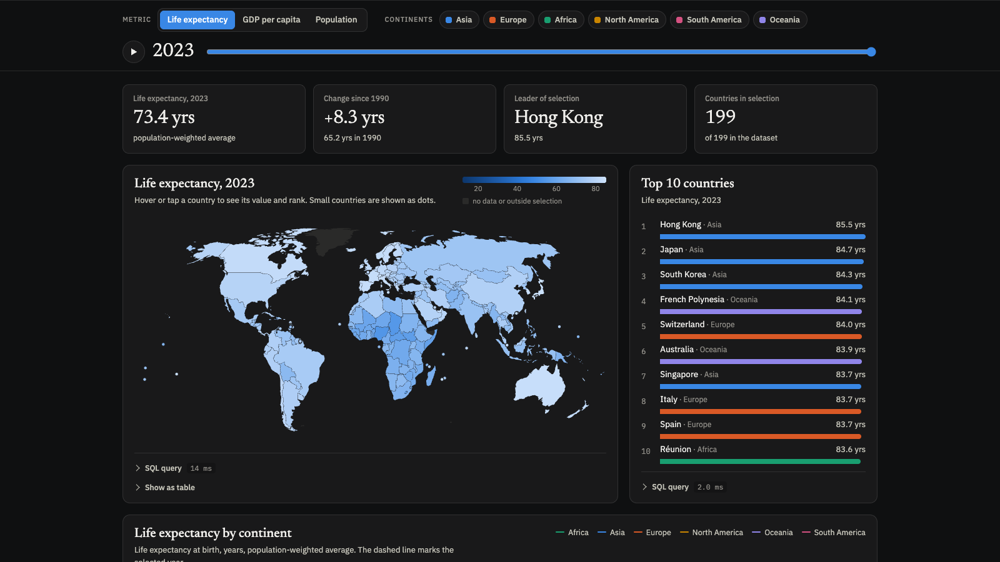
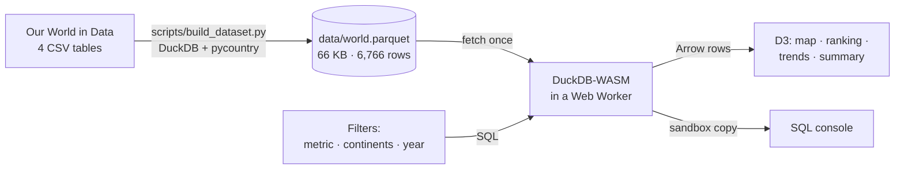
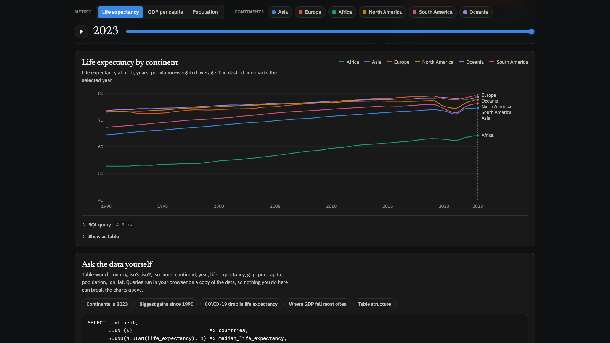
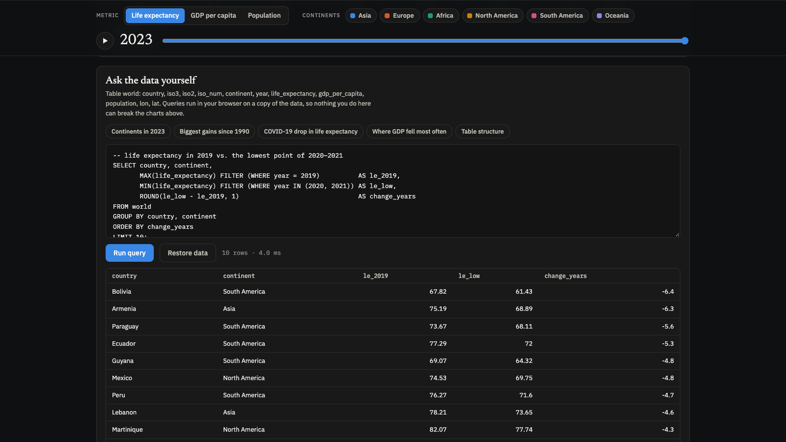

# How the World Lives, 1990–2023

**An interactive data story about life expectancy, wealth and population in 199 countries and territories. Every filter runs a real SQL query in your browser.**

[](https://kasianeno.github.io/how-the-world-lives/)
[](https://duckdb.org/docs/api/wasm/overview)
[](https://d3js.org)
[](https://ourworldindata.org/faqs#can-i-use-or-reproduce-your-data)
[](LICENSE)

[](https://kasianeno.github.io/how-the-world-lives/)

**[Open the live dashboard →](https://kasianeno.github.io/how-the-world-lives/)**

---

## Overview

The page combines a choropleth map, an animated top-10 ranking, continent trend lines and summary figures for three indicators from [Our World in Data](https://ourworldindata.org): life expectancy at birth, GDP per capita (PPP) and population, for every year from 1990 to 2023.

There is no backend. The cleaned dataset ships next to the page as a 66 KB Parquet file, and [DuckDB-WASM](https://duckdb.org/docs/api/wasm/overview) runs an analytical SQL engine inside the browser tab. Each click on a metric, continent or year builds a SQL query, runs it in a few milliseconds and redraws the charts. Every chart shows the exact query behind it, and an SQL console at the bottom lets visitors ask their own questions of the data.

## Key findings

All figures are population-weighted and computed from the dataset in this repository.

- **People live 8.2 years longer than in 1990.** Global life expectancy rose from 65.2 years in 1990 to 73.4 in 2023.
- **The gap between countries narrowed by a third.** The difference between the highest and the lowest life expectancy fell from 50.4 years in 1990 to 31.1 in 2023. The largest gains came from South Sudan (+29.0 years), Liberia (+24.5) and Malawi (+23.8).
- **COVID-19 set the world back almost a decade, then it recovered.** Global life expectancy fell from 72.9 in 2019 to 71.2 in 2021, the level of 2012, and 175 of 199 countries recorded a drop. Bolivia (−6.4 years), Armenia (−6.3) and Paraguay (−5.6) were hit hardest. By 2022 the world was back above its pre-pandemic level.
- **Asia and Africa started level and diverged.** In 1990 both had a GDP per capita of about $4,700–4,900 (PPP, 2021 prices). By 2023 Asia's had grown 3.5× to $16,993, while Africa's grew 1.3× to $6,299.
- **The world added 2.8 billion people,** from 5.3 billion in 1990 to 8.1 billion in 2023.

## Features

- **World map** with a fixed colour scale across all years, so changes over time are comparable. Small states that the 1:110m atlas cannot draw (29 of them, from Singapore to Barbados) appear as dots at their centroid.
- **Year slider and playback** through all 34 years, with animated transitions on the map, the ranking and the trend lines.
- **Top-10 ranking** that reorders smoothly as the year or filter changes. Continent is shown as text as well as colour.
- **Continent trends** with a crosshair tooltip. Click a year on the chart to jump to it.
- **Summary figures:** weighted average, change since 1990, leader of the current selection, and how many countries have no data for the chosen metric.
- **"Show the SQL"** under every chart, with syntax highlighting and query timing.
- **SQL console** with five example analyses (window functions, `FILTER`, `LAG`, lateral column aliases). It runs on a sandboxed copy of the table, so `DROP` or `UPDATE` cannot break the dashboard.
- **Three languages** (English, Polish, Ukrainian), including localised number formats, plural rules and country names via `Intl.DisplayNames`.
- **Light and dark themes,** remembered per visitor.
- **Accessible table views** of the map and the trend chart, keyboard focus styles, and `prefers-reduced-motion` support.

## How it works



1. **Build time (Python).** `scripts/build_dataset.py` downloads the source tables, joins them on ISO code and year in DuckDB, filters and enriches them, and writes `data/world.parquet`.
2. **Page load.** The browser downloads the DuckDB-WASM engine from jsDelivr (about 6 MB compressed, cached afterwards) and the Parquet file, then loads the data into an in-memory table.
3. **Interaction.** Each filter change runs four queries (map, ranking, trends, summary). Stale results are discarded if the visitor moves on before they finish.

### Why a database in the browser?

A static site usually means pre-computing a JSON file for every possible filter combination, or running a server that costs money and goes to sleep. Running DuckDB in the browser gives arbitrary SQL over the full dataset with free static hosting, and the queries the visitor sees are the queries that actually ran.

## Data

### Sources

| Indicator | Source (via Our World in Data) | Unit |
|---|---|---|
| Life expectancy at birth | UN World Population Prospects 2024; Human Mortality Database; Zijdeman et al.; Riley | years |
| GDP per capita | World Bank, Eurostat, OECD, IMF (2026) | international $, PPP, constant 2021 prices |
| Population | UN World Population Prospects 2024; HYDE; Gapminder | people |
| Continent | Our World in Data regions | — |

Country centroids for small states come from [gavinr/world-countries-centroids](https://github.com/gavinr/world-countries-centroids). Borders come from [Natural Earth](https://www.naturalearthdata.com) via [world-atlas](https://github.com/topojson/world-atlas).

### Processing

- Years 1990–2023, the period where all three indicators overlap.
- Countries and territories with more than 100,000 people in 2023 (199 in total). OWID aggregates such as "World" or "High-income countries" are removed.
- ISO alpha-2 and numeric codes are added with `pycountry` to join with the map and translate country names.

### Data dictionary: `data/world.parquet`

| Column | Type | Description |
|---|---|---|
| `country` | VARCHAR | Country or territory name (OWID) |
| `iso3`, `iso2`, `iso_num` | VARCHAR | ISO 3166-1 alpha-3, alpha-2 and numeric codes |
| `continent` | VARCHAR | Africa, Asia, Europe, North America, South America, Oceania |
| `year` | SMALLINT | 1990–2023 |
| `life_expectancy` | DOUBLE | Life expectancy at birth, years |
| `gdp_per_capita` | DOUBLE | GDP per capita, PPP, constant 2021 international $. `NULL` where not reported |
| `population` | BIGINT | Population |
| `lon`, `lat` | DOUBLE | Country centroid, used for countries too small for the map |

### Methodology notes

- **Weighted averages ignore missing values in the denominator.** GDP is missing for 639 of 6,766 country-years (for example Venezuela, Cuba, North Korea, Taiwan and Yemen). A naive `SUM(gdp * pop) / SUM(pop)` counts those populations without their GDP and understates the average, by about 7% for South America in 2023. The page uses:

  ```sql
  SUM(gdp_per_capita * population)
    / SUM(population) FILTER (WHERE gdp_per_capita IS NOT NULL)
  ```

- **Colour scales are fixed across years** (log scale for GDP and population), so the map does not re-normalise every frame and change over time stays visible.
- **Ranks are computed in SQL** with `RANK() OVER (ORDER BY … DESC)` on the current selection only.

### Known limitations

- GDP coverage changes slightly over time (175 of 199 countries in 1990, 181 in 2023), which affects continent averages at the margin.
- Life expectancy for recent years in some countries is a UN estimate, not an observed value.
- French Guiana, Guadeloupe, Martinique, Mayotte and Réunion are separate entries in the data but part of France on the 1:110m map, so they appear as dots.

## Run locally

The page needs to be served over HTTP; opening `index.html` directly from disk will not load the data.

```bash
git clone https://github.com/kasianeno/how-the-world-lives.git
cd how-the-world-lives
python3 -m http.server 8000
```

Then open <http://localhost:8000>.

## Rebuild the dataset

```bash
python3 -m venv .venv
.venv/bin/pip install -r scripts/requirements.txt
.venv/bin/python scripts/build_dataset.py
```

The script downloads the latest tables from Our World in Data into `data/.cache/` and rewrites `data/world.parquet`. With the data as of November 2026 it reproduces the committed file exactly.

## Project structure

```
.
├── index.html                # the whole app: markup, styles, copy in 3 languages, SQL, D3 charts
├── data/
│   ├── world.parquet         # cleaned dataset (66 KB)
│   └── countries-110m.json   # world borders, TopoJSON
├── scripts/
│   ├── build_dataset.py      # reproducible data pipeline
│   └── requirements.txt
└── docs/                     # screenshots for this README
```

## Tech stack

| Layer | Tools |
|---|---|
| Data pipeline | Python, DuckDB, pycountry |
| Storage | Apache Parquet (zstd) |
| In-browser engine | DuckDB-WASM 1.29 |
| Visualisation | D3.js 7.9, TopoJSON, Natural Earth projection |
| Front end | Vanilla JavaScript (ES modules), CSS custom properties, no build step |
| Hosting | GitHub Pages |

## Screenshots

| Continent trends | SQL console |
|---|---|
|  |  |

## License and attribution

- **Code:** [MIT](LICENSE).
- **Data:** [Our World in Data](https://ourworldindata.org), licensed under [CC BY 4.0](https://creativecommons.org/licenses/by/4.0/). Underlying sources: UN World Population Prospects 2024, Human Mortality Database, World Bank, HYDE, Gapminder.
- **Map:** Natural Earth (public domain) via world-atlas (ISC).
